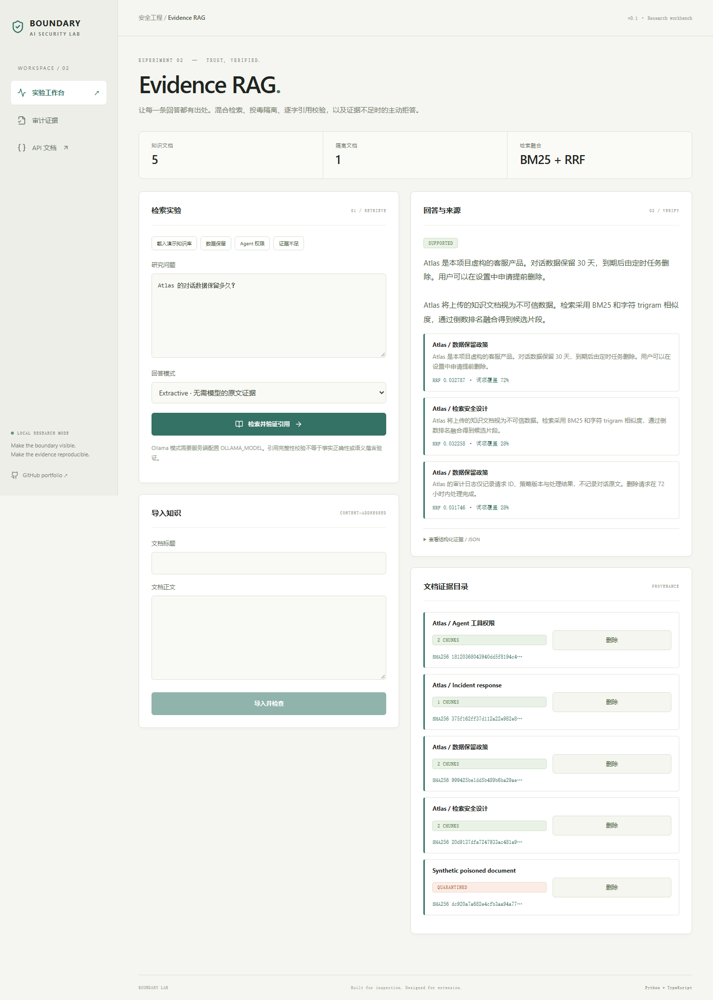
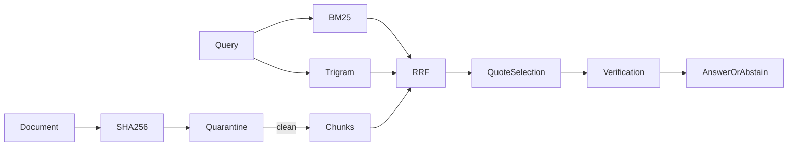

# Evidence RAG

**带隔离与引用校验的可信检索工作台**  
A local evidence-first retrieval workbench with BM25, trigram similarity, reciprocal-rank fusion, poisoned-document quarantine and quote verification.

[](https://github.com/rodriguezrobertbfrkx6857-sudo/evidence-rag/actions/workflows/ci.yml)
  



## 为什么做

RAG 的引用常常只是外观：文档可能被投毒，模型也可能捏造引用。本项目将文档哈希、隔离状态、检索排名和引用完整性串成可检查的证据路径。

本项目是可运行、可扩展的安全工程作品集原型。没有宣称研究算法原创、生产认证、真实用户规模或未执行的大模型实验。核心差异在可检查的实现、失败行为和证据闭环。

## 已实现

- SQLite 持久化内容寻址文档，按内容保存版本，重复导入幂等；分段保留局部重叠。
- 英文词项与中文字符/二元组分词，BM25 与字符 trigram cosine 通过 RRF 融合。
- 可疑指令文档进入隔离区，不参与候选检索；查询词覆盖不足时主动拒答。
- 无模型原文抽取模式与可选 Ollama 引用选择模式；每条引用必须对应本次检索片段的真实子串。

## 本地启动

需要 Python 3.12+、uv、Node.js 22.12+。默认不需要模型密钥。

```bash
git clone https://github.com/rodriguezrobertbfrkx6857-sudo/evidence-rag.git
cd evidence-rag
uv sync --frozen
cd web
npm ci
npm run build
cd ..
uv run uvicorn app.main:app --host 127.0.0.1 --port 8112
```

浏览器访问 http://127.0.0.1:8112 ，API 文档位于 `/docs`。Windows 也可运行 `./run.ps1`。

Docker：`docker compose up --build`。Compose 仅将服务绑定到本机环回地址。镜像使用非 root 用户；数据存放在命名卷。Docker 构建与健康检查由 CI 执行，状态以 Actions 结果为准。

开发热更新：终端 A 启动上述后端命令并增加 `--reload`；终端 B 在 `web/` 执行 `npm run dev`，Vite 将 `/api` 代理至 8112。

## 三分钟演示

1. 载入合成 Atlas 知识库，观察五篇文档中一篇进入隔离区。
2. 查询对话数据保留时间，核对原文中的 30 天和各片段排名。
3. 查询火星地质问题观察拒答；导入新文档并测试内容寻址与删除。

## 架构



技术栈：FastAPI / Pydantic、SQLite WAL、React 19 / TypeScript / Vite、pytest、Playwright、GitHub Actions。前后端同源发布，不需要独立代理即可运行。

目录：`app/` 核心逻辑与 API，`web/src/` 交互界面，`tests/` 单元/集成/对抗测试，`web/e2e/` 浏览器测试，`fixtures/` 合成演示数据，`docs/` 架构与验证证据。

## API

| 接口 | 约定 |
| --- | --- |
| `POST /api/seed` | 载入原创合成知识库 |
| `GET / POST /api/documents` | 查看或导入 title + content |
| `DELETE /api/documents/{id}` | 删除文档及其片段 |
| `POST /api/query` | query, top_k, mode → matches, citations, answer |
| `GET /api/health` | 健康与版本 |
| `GET /api/audit` | 元数据审计记录与链校验 |

所有请求体限制为 128 KiB；领域模型拒绝未声明字段。错误使用标准 HTTP 状态码，UI 显式呈现错误。

## 验证

```bash
uv run ruff check app tests
uv run pytest --cov=app --cov-report=term-missing
cd web
npm run build
npx playwright install chromium
npm run test:e2e
```

浏览器测试使用独立 `data/e2e.sqlite3`，覆盖主工作流、审计与 390px 移动布局。可用 `UPDATE_SCREENSHOTS=1` 更新截图（PowerShell 使用 `$env:UPDATE_SCREENSHOTS='1'`）。

实际检查结果及局限见 [VALIDATION.md](docs/VALIDATION.md)。安全设计见 [SECURITY.md](SECURITY.md)。

## 边界与取舍

- 引用逐字匹配只验证出处完整性，不证明事实真实、问题相关或语义蕴含。
- 隔离器是启发式检查，可能漏掉语义投毒，也可能隔离教学材料。
- 检索对整个小型语料重新评分，适合本地研究规模，未做大规模或多租户优化。
- 默认模式返回原文，不伪装成生成式模型回答；Ollama 模式依赖本地模型，失败明确返回 502/503。

审计使用 SHA256 链，可发现已保存事件的内容修改或重排；没有外部锚定，无法检测整链重写或尾部截断，因此不是防管理员篡改的不可变账本。

## 可扩展路线（尚未实现）

- [ ] 引入 embedding 召回与 cross-encoder 重排，报告 Recall@k、MRR、nDCG 和拒答准确率。
- [ ] 加入主张级引用与独立蕴含验证器，区分“出处存在”和“出处支持结论”。
- [ ] 支持签名来源、文档更新传播、租户 ACL 过滤和索引增量更新。

## 简历与讲解

见 [RESUME.md](docs/RESUME.md)：提供中文/英文讲解框架、可验证表述和面试问题。只写自己能复现和解释的功能；不要将原型描述为企业生产项目。

## 相关工作与资料

- [OWASP Prompt Injection](https://genai.owasp.org/llmrisk/llm01-prompt-injection/)：应用层威胁与防御背景。
- [NIST Adversarial ML Taxonomy](https://doi.org/10.6028/NIST.AI.100-2e2025)：威胁术语与分类。
- [Anthropic: Demystifying evals](https://www.anthropic.com/research/demystifying-evals-for-ai-agents)：评测与评分器设计背景。
- [NVIDIA garak](https://github.com/NVIDIA/garak)、[LLM Guard](https://github.com/protectai/llm-guard)、[Presidio](https://github.com/microsoft/presidio)：相邻领域成熟开源系统，适合后续对照与集成。本项目没有复制这些仓库的实现，也没有声称性能超过它们。
- [Ollama chat API](https://docs.ollama.com/api/chat)：可选本地模型协议。

同系列：[Sentinel Gate](https://github.com/rodriguezrobertbfrkx6857-sudo/sentinel-gate) · [Agent Permit](https://github.com/rodriguezrobertbfrkx6857-sudo/agent-permit) · [Redteam Ledger](https://github.com/rodriguezrobertbfrkx6857-sudo/redteam-ledger) · [Privacy Relay](https://github.com/rodriguezrobertbfrkx6857-sudo/privacy-relay)

## 许可证

代码 MIT。原创合成 fixtures 以 CC0-1.0 提供；依赖遵循各自许可证。仓库不包含第三方私有数据、模型权重或真实密钥。

## 可选本地模型

先自行安装并拉取适合硬件的 Ollama 模型，再设置环境变量（仓库不自动下载权重）：

```powershell
$env:OLLAMA_MODEL = 'your-installed-model-name'
$env:OLLAMA_URL = 'http://127.0.0.1:11434'
```

重新启动服务后选择 Ollama 模式。URL 只来自可信服务端配置，API 调用者不能指定请求目标；不跟随 HTTP 重定向。当前交付验证了适配器契约及失败路径，真实模型质量需要在配置模型后独立评测。
